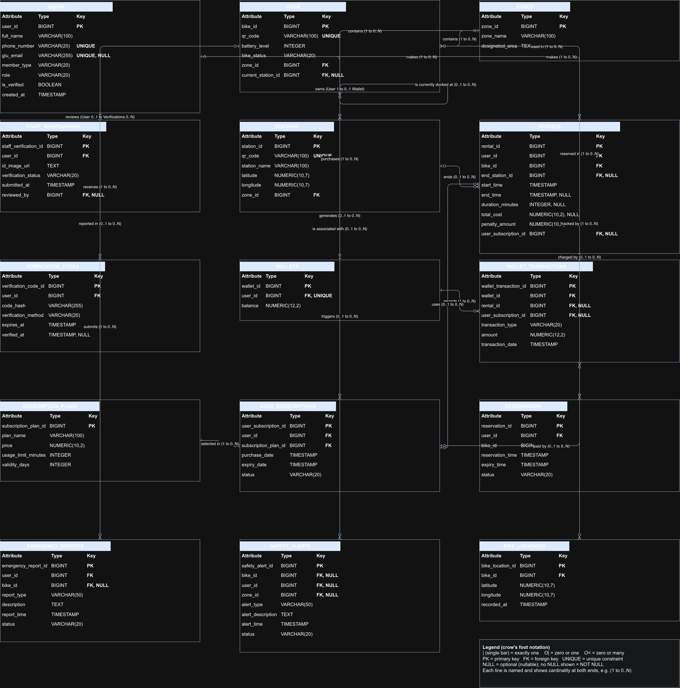

# smart-bike-rental-precinct99
 “Smart Bike Rental App — GIU Software Engineering”
 Team name: Precinct99
## Team

| Name | Student ID | Role |
|---|---|---|
| Salma Sameh | 16008950 | Team leader |
| Abdelrahman Tarek | 16009292 | Member |
| Sama Khalil | 17006293 | Member |
| Yassin Omran | 16004436 | Member |
| Ziena Ewis | 16003305 | Member |
| Kirollos Sedarouse | 16002146 | Member |
| Ahmed Hossam | 16006332 | Member |
| Judy Adel | 16002314 | Member |
| Ali Azim | 16003412 | Member |
| Omar Sharaf | 16002472 | Member |

## ERD

Editable diagram: [Open the draw.io source](docs/erd.drawio)

## Traceability: Entities to User Stories

References use the finalized backlog in Section 3.5.4 of the
Milestone 1 document, "Final all.docx".

| Entity | Supporting user stories |
|---|---|
| users | US-001, US-002, US-003, US-011 |
| verification_codes | US-001, US-002 |
| staff_verifications | US-002 |
| bikes | US-003, US-005, US-006, US-015 |
| zones | US-012, US-014 |
| stations | US-005, US-010, US-017 |
| rentals | US-003, US-004, US-008, US-010 |
| wallets | US-004 |
| wallet_transactions | US-004, US-007, US-008 |
| subscription_plans | US-007 |
| user_subscriptions | US-004, US-007 |
| reservations | US-009 |
| emergency_reports | US-011 |
| safety_alerts | US-012, US-013, US-014, US-016, US-017 |
| bike_locations | US-005, US-012, US-013, US-017 |

## Database

- DBMS: PostgreSQL 18.7
- Database name: `smart_bike_rental`
- Database management tool: pgAdmin 4
- SQL scripts location: `schema/`

### Setup and execution order

Create an empty PostgreSQL database named `smart_bike_rental`.
Open pgAdmin's Query Tool connected to that database.

Run the complete scripts in this order:

1. `schema/01_create_tables.sql` — creates 15 tables, constraints,
   and indexes.
2. `schema/03_seed_data.sql` — inserts fictional sample data.
3. `schema/04_test_constraints.sql` — runs seven constraint tests.
   Expected output: PASS 1–7. The final ROLLBACK removes test reservations.

Run the creation and seed scripts once on an empty database.
They are not designed to be rerun on an already populated database.